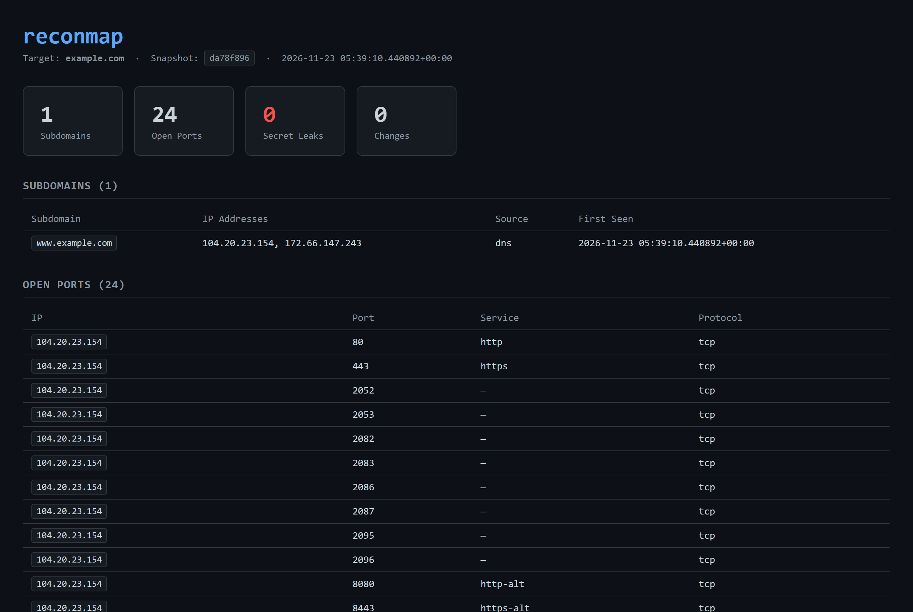

# reconmap

[](https://github.com/dragonday3/reconmap/actions/workflows/ci.yml)
[](https://www.python.org/downloads/)
[](LICENSE)

**Passive Attack Surface Intelligence Platform** — map a domain's subdomains, open ports and leaked secrets by combining Certificate Transparency logs (crt.sh), Shodan InternetDB, GitHub code search and DNS resolution. Every scan is stored as a snapshot, and reconmap reports what changed since the last one, ranked by severity, as JSON or a dark-theme HTML report.

Run it on a schedule (cron, or a scheduled GitHub Actions workflow) to monitor a domain over time; see [Scheduled monitoring](#scheduled-monitoring).



<sub>HTML report from `reconmap scan example.com --output html` (crt.sh was unavailable during this run, so subdomains come from DNS only).</sub>

---

## Install

### From source

```bash
git clone https://github.com/dragonday3/reconmap.git
cd reconmap
pip install -e .            # add ".[dev]" for tests
```

### Docker (build locally)

```bash
git clone https://github.com/dragonday3/reconmap.git && cd reconmap
docker build -t reconmap .
docker run --rm reconmap --help
```

> reconmap is not published on PyPI or Docker Hub yet; install from this repository.

---

## Quick Start

### Scan a domain

```bash
# Basic scan — JSON output to stdout
reconmap scan example.com

# With API keys
reconmap scan example.com \
  --github-token $GITHUB_TOKEN \
  --shodan-key $SHODAN_API_KEY

# Save HTML report
reconmap scan example.com --output html --out-file report.html

# Save JSON report
reconmap scan example.com --output json --out-file results.json

# Quiet mode (no progress, no tables — only the report)
reconmap scan example.com --quiet
```

### Diff two snapshots

```bash
# Compare the latest two stored snapshots for a domain
reconmap diff example.com --db-url sqlite+aiosqlite:///reconmap.db

# Output as HTML
reconmap diff example.com --output html --out-file diff.html
```

### Start the REST API

```bash
reconmap serve --host 0.0.0.0 --port 8000
```

### Docker Compose

```bash
echo "RECONMAP_GITHUB_TOKEN=ghp_your_token" > .env   # optional, raises GitHub search rate limits
docker compose up
# API available at http://localhost:8000
```

---

## Scheduled monitoring

reconmap has no built-in scheduler: each `scan` stores a snapshot and `diff` compares the latest two. Run both on a schedule to monitor a domain, for example with GitHub Actions:

```yaml
name: reconmap-weekly
on:
  schedule:
    - cron: "0 6 * * 1"   # Mondays 06:00 UTC
jobs:
  recon:
    runs-on: ubuntu-latest
    steps:
      - run: pip install "git+https://github.com/dragonday3/reconmap.git"
      - run: reconmap scan example.com --quiet --output json --out-file scan.json
        env:
          RECONMAP_GITHUB_TOKEN: ${{ secrets.RECON_GITHUB_TOKEN }}
      - run: reconmap diff example.com --output html --out-file diff.html
```

Snapshots live in the database (`DATABASE_URL`), so a scheduled runner needs persistent storage (for example a cached SQLite file or an external database) for `diff` to have a previous snapshot to compare against.

---

## CLI Reference

### `reconmap scan DOMAIN`

Run a passive recon scan against DOMAIN.

| Option | Env Var | Default | Description |
|--------|---------|---------|-------------|
| `--github-token TEXT` | `RECONMAP_GITHUB_TOKEN` | — | GitHub personal access token for secret scanning |
| `--shodan-key TEXT` | `RECONMAP_SHODAN_KEY` | — | Shodan API key for port/banner data |
| `--output / -o TEXT` | — | `json` | Output format: `json` or `html` |
| `--out-file / -f TEXT` | — | stdout | Write report to this file path |
| `--no-dns` | — | false | Skip DNS brute-force/resolution step |
| `--quiet / -q` | — | false | Suppress progress and summary tables |

Exit code: `1` if any secret leaks were found; `0` otherwise.

### `reconmap diff DOMAIN`

Diff the latest two snapshots stored in the database for DOMAIN.

| Option | Env Var | Default | Description |
|--------|---------|---------|-------------|
| `--output / -o TEXT` | — | `json` | Output format: `json` or `html` |
| `--out-file / -f TEXT` | — | stdout | Write report to this file path |
| `--db-url TEXT` | `DATABASE_URL` | SQLite `./reconmap.db` | Database connection URL |
| `--quiet / -q` | — | false | Suppress change table output |

Exit code: `1` if any critical or high severity changes were found; `0` otherwise.

### `reconmap serve`

Start the reconmap REST API server.

| Option | Env Var | Default | Description |
|--------|---------|---------|-------------|
| `--host TEXT` | — | `127.0.0.1` | Bind host |
| `--port INT` | — | `8000` | Bind port |
| `--db-url TEXT` | `DATABASE_URL` | SQLite `./reconmap.db` | Database connection URL |

---

## Python SDK

```python
import asyncio
from reconmap.sdk import ReconMap
from reconmap.reporters import JSONReporter, HTMLReporter

async def main():
    rm = ReconMap(
        shodan_key="YOUR_KEY",
        github_token="YOUR_TOKEN",
        db_url="sqlite+aiosqlite:///./reconmap.db",
    )

    # Run a scan and persist the snapshot
    snapshot = await rm.scan("example.com")
    print(f"Found {len(snapshot.subdomains)} subdomains, {len(snapshot.leaks)} leaks")

    # Diff the two most recent snapshots
    changes = await rm.diff("example.com")
    for change in changes:
        print(f"[{change.severity}] {change.change_type}: {change.asset_key}")

    # Generate reports
    json_reporter = JSONReporter()
    json_reporter.write(snapshot, "report.json")

    html_reporter = HTMLReporter()
    html_reporter.write(snapshot, "report.html", changes=changes)

    await rm.close()

asyncio.run(main())
```

---

## REST API

Base URL: `http://localhost:8000`

| Method | Endpoint | Description |
|--------|----------|-------------|
| `GET` | `/health` | Health check + version |
| `POST` | `/targets` | Register a new target domain |
| `GET` | `/targets` | List all tracked targets |
| `POST` | `/targets/{domain}/scan` | Trigger a passive scan |
| `GET` | `/targets/{domain}/snapshots` | List snapshots (newest first) |
| `GET` | `/targets/{domain}/snapshots/latest` | Get the latest snapshot |
| `GET` | `/targets/{domain}/changes` | List detected changes |

Interactive docs available at `http://localhost:8000/docs`.

---

## Architecture

```
reconmap
├── collectors/          Data-source adapters (passive only)
│   ├── crtsh.py         Certificate Transparency logs (crt.sh query)
│   ├── shodan.py        Shodan InternetDB open ports (free, no key)
│   ├── github.py        GitHub code search (secret leaks)
│   └── dns_resolver.py  DNS A-record resolution of discovered hosts + 20 common prefixes
│
├── engine/
│   ├── scanner.py       Orchestrates collectors → AssetSnapshot
│   └── diff.py          Diffs two snapshots → list[Change]
│
├── models/
│   └── asset.py         Pydantic models: AssetSnapshot, Change, etc.
│
├── storage/
│   └── db.py            Async SQLAlchemy storage (SQLite by default, DATABASE_URL)
│
├── reporters/
│   ├── json_reporter.py  JSON serialization
│   └── html.py           Jinja2 dark-theme HTML report
│
├── api/
│   └── app.py           FastAPI REST endpoints
│
├── cli.py               Typer CLI (scan / diff / serve)
└── sdk.py               High-level Python SDK

templates/
└── report.html.j2       Self-contained dark-theme HTML template
```

**Data flow:**

```
User / CI
   │
   ▼
reconmap scan example.com
   │
   ▼
Scanner.run(domain)
   ├──► CrtShCollector  ──┐
   ├──► ShodanCollector       ├──► AssetSnapshot (merged)
   ├──► GitHubCollector       ┘
   └──► DNSResolverCollector ──► Enrich subdomains with IPs
   │
   ▼
DiffEngine.diff(before, after) ──► list[Change]
   │
   ▼
Storage.save_snapshot()  +  Storage.save_changes()
   │
   ▼
JSONReporter / HTMLReporter ──► report.json / report.html
```

---

## Data Sources

| Source | What it provides | Requires |
|--------|-----------------|---------|
| Certificate Transparency (crt.sh) | Subdomain enumeration | Nothing (public API) |
| Shodan InternetDB | Open ports per resolved IP | Nothing (free API; `--shodan-key` is accepted but not used yet) |
| GitHub Code Search | Secret/credential leaks in public code (AWS keys, JWTs, private keys, API keys, passwords, GitHub tokens; masked in logs) | `RECONMAP_GITHUB_TOKEN` optional (higher rate limit) |
| DNS resolver | A records for discovered subdomains plus 20 common prefixes (`www`, `api`, `dev`, `vpn`, …) | Nothing |

**Passive-first:** crt.sh, Shodan InternetDB and GitHub search never touch the target. DNS resolution sends ordinary DNS lookups through your resolver, including 20 guessed common names (skip with `--no-dns`). No port scanning or HTTP probing of the target is performed.

--------|-----------------|---------|
| Certificate Transparency (crt.sh) | Subdomain enumeration | Nothing (public API) |
| Shodan | Open ports, banners, service fingerprints | `RECONMAP_SHODAN_KEY` |
| GitHub Code Search | Secret/credential leaks in public repos | `RECONMAP_GITHUB_TOKEN` |
| DNS Resolver | IP addresses for discovered subdomains | Nothing |

All data collection is **passive** — no active probing or port scanning is performed against the target.

---

## Development Setup

```bash
# Clone and install in editable mode with dev dependencies
git clone https://github.com/dragonday3/reconmap.git
cd reconmap
pip install -e ".[dev]"

# Run tests
pytest tests/ -q

# Run with coverage
pytest --cov=reconmap --cov-report=term-missing tests/

# Lint (optional)
ruff check src/
mypy src/
```

### Environment variables for integration tests

```bash
export RECONMAP_GITHUB_TOKEN=ghp_...
export RECONMAP_SHODAN_KEY=...
export DATABASE_URL=sqlite+aiosqlite:///./reconmap.db
```

---

## Authorized Use Only

Only run reconmap against domains you own or are authorized to assess. Leaked credentials it finds belong to someone: report them responsibly and never use them.

---

## License

MIT — see [LICENSE](LICENSE) for details.
